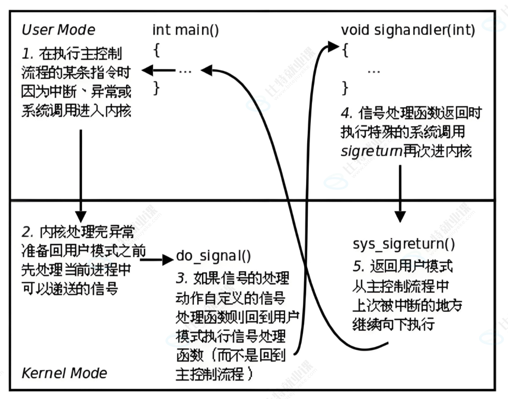

## 产生信号的五种方式
1. 软件产生
2. 硬件产生
3. 系统调用产生
4. 按键产生
5. 命令产生(本质系统调用)

### 常见按键产生信号
1. `ctrl + c`: 发送2号信号SIGINT, 默认动作终止进程
2. `ctrl + z`: 发送20号信号SIGTSTP, 默认动作挂起进程
3. `ctrl + \`: 发送3号信号SIGQUIT, 终止进程并产生core dump.

- bash进程默认忽略了所有的信号

> **Caution**: 键盘产生信号只能控制前台进程

只有两个信号无法被阻塞、捕获或忽略：

| 信号      | 信号编号           | 作用       |
| ------- | -------------- | -------- |
| SIGKILL | 9              | 强制终止进程   |
| SIGSTOP | 19（Linux 常见架构） | 强制暂停进程执行 |

### 进程无法被kill杀死的情况
1. 这个进程阻塞了信号  
2. 用户有可能自定义了信号的处理方式  
3. 这个进程有可能是僵尸进程  
4. 这个进程当前状态是停止状态

*硬件如何产生信号?*
以除0错误为例: 当CPU计算单元遇到除0时, 标志位寄存器中存在可信标志位被置1, 而后由操作系统捕捉到并向对应的进程发送相应的信号.

# Core Dump核心转储
**核心转储（Core Dump）是指程序异常终止时，操作系统将其内存状态及相关运行信息保存到文件中，以便分析和调试程序故障.**

例如除零错误引发的SIGFPE有可能引发核心转储. 

1. 异常引发核心转储时, 进程会在内存中产生错误信息并将其转移到磁盘上, 生成core文件. 
2. 该文件是一个二进制文件, 可以被GDB调用并快速定位程序发生错误的位置.

# 信号的保存
在tack_struct中有两个位图和一个数组: 
1. block位图: 表示被阻塞的信号
2. pending位图: 表示未决的信号
3. handler函数指针数组: 表示信号的默认处理方式

- 对于`sigset_t`类型, 其底层是unsigned long int类型, 是一个位图, 用来记录哪个信号被添加到了集合中. 其本质是一个信号的集合, 仅仅记录哪些信号被放入其中, 而不记录信号的其他任何信息. 

位图与函数指针数组均使用下标来表示信号的序号.位图用0与1表示信号的状态. 

### 区分: 信号的忽略与阻塞
1. 信号被忽略时, 信号可以到达并改变pending位图. 但是进程收到信号选择忽略它, 随后pending该位被置为0.
2. 阻塞信号只会改变 Block 位图；阻塞期间如果该信号产生，Pending 位图的对应位就会置为 1。同时进程不做出任何反应.
3. 对于`2`情况, 解除阻塞后, 该信号将会递达并被进程处理. 
4. **对于同一个常规信号, 在递达之前产生多次只计一次**

## 信号的处理 
见下图:

补充: 
1. 第二步内核需要判断信号是否未决, 或者被阻塞. 另外, **内核还需要保存进程的上下文信息到用户空间的信号栈帧中, 包括寄存器信息, 计数器信号屏蔽字等**
其中, 第5步本质是恢复被信号打断前的执行上下文，包括 CPU 寄存器、信号屏蔽字等，然后恢复原来的用户态执行流程。
2. 第三步中, Handler并不会像执行普通C函数一样在内核态直接执行回调函数, 而是构造信号栈帧, 改变用户态执行上下文, 使 CPU 返回用户态后执行处理函数。
3. 第 5 步的本质是恢复被信号打断前的执行上下文，包括 CPU 寄存器、信号屏蔽字等，然后恢复原来的用户态执行流程。

> 该流程形似无穷符号, 其中, 进程4次改变状态, 两次进入内核态, 两次进入用户态. 

# 扩展: 中断与操作系统

**中断的概念**: 中断是指计算机在执行程序过程中，遇到需要紧急处理的事件时，CPU暂时停止当前程序的执行，转而执行相应的中断处理程序，处理完成后再返回原程序继续执行的过程。

## 操作系统处理中断主要分为以下 5 个步骤
1. 中断请求：外部设备或程序向 CPU 发出中断请求。
2. 中断响应：CPU 执行完当前指令后，检测并响应中断。
3. 保护现场：保存当前程序的执行状态，如程序计数器（PC）、程序状态字（PSW）及相关寄存器。
4. 中断处理：根据中断向量找到对应的中断处理程序（ISR），执行中断服务。
5. 恢复现场：恢复之前保存的执行状态，通过中断返回指令继续执行原程序。

- 中断向量表（Interrupt Vector Table，IVT） 是操作系统中用于存储各类中断对应的中断处理程序入口地址的数据结构。

## 硬件中断
1. 由外部设备触发的，中断系统运行流程，叫做硬件中断
2. 中断控制器: 用来保存外围部件产生的中断及其序号, 并通知CPU处理中断以及中断信息
3. 通过外部硬件中断，操作系统就不需要对外设进行任何周期性的检测或者轮询.

### 时钟中断
在CPU内部存在时钟源, 定期向CPU发送中断.
操作系统本质上是一个死循环, 由硬件时钟驱动, 定期(在时间片内)执行中断

## 软中断
由软件产生的中断. 
系统调用底层本质上是中断. 中断向量表(IDT)内保存有指针, 该指针指向系统调用的函数指针表. 系统调用发生时查找该表并发生相应的中断. 
用户层怎么把系统调用号给操作系统？
    - 寄存器(比如EAX) 
 - 操作系统怎么把返回值给用户？- 
   - 寄存器或者用户传入的缓冲区地址 
 - 系统调用的过程，其实就是先int 0x80、syscall陷入内核，本质就是触发软中断，CPU就会自动执行系统调用的处理方法，而这个方法会根据系统调用号，自动查表，执行对应的方法
 - 系统调用号的本质：数组下标
